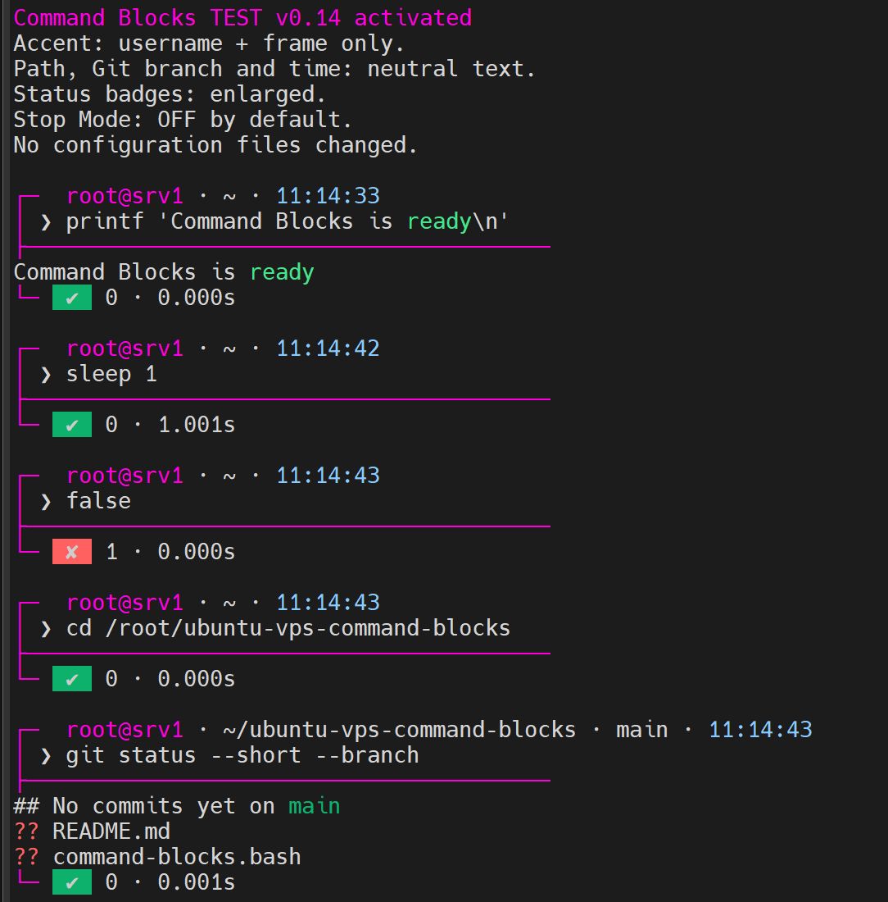

# Ubuntu VPS Command Blocks

Experimental interactive Bash prompt with visual command boundaries, execution status, timing, and independently configurable batch grouping and stop-on-error behavior.

Built for Ubuntu VPS administration over SSH.

## Preview

## Features

- Visual command blocks with input/output boundaries
- Exit codes and execution duration
- Git branch and working directory in the prompt
- ANSI accent color controlled by the terminal palette
- Manual spacing using empty Enter or `cbgap`
- Independent batch grouping and stop-on-error settings
- Four combinations of execution behavior
- Fail-fast execution isolated from the interactive shell
- Interrupt reporting and recovery
- Temporary shell without modifying Bash configuration

## Quick start

Run from an existing interactive Bash session:

    bash ./command-blocks.bash

This starts a temporary nested Bash session. No installation is performed.

Press `Ctrl+D` inside Command Blocks to return to the parent shell. Do not use `Ctrl+D` from the original SSH shell unless you intend to disconnect.

## Commands

| Command | Description |
| --- | --- |
| `cb status` | Show all four mode settings |
| `cb batch separate` | Display separate command blocks |
| `cb batch grouped` | Display one block for a pasted batch |
| `cb batch status` | Show the batch mode |
| `cb stop on` | Stop on an unhandled batch failure |
| `cb stop off` | Continue after errors |
| `cb stop status` | Show the stop mode |
| `cbgap N` | Add 1–15 blank lines between command groups |
| `cb border on/off/status` | Experimental output borders; default OFF |
| `cb clip on/off/status` | Copy command output via X11; default OFF |

Default: **Separate + Stop OFF**, **Border OFF**.

Run mode-control commands separately at the interactive prompt.

## Execution modes

Batch grouping and stop-on-error behavior are independent.

| Batch mode | Stop OFF | Stop ON |
| --- | --- | --- |
| Separate | Individual blocks, continue | Individual blocks, fail-fast |
| Grouped | One block, continue | One block, fail-fast |

These settings primarily control multiline pasted input.

### Separate + Stop OFF

Normal interactive Bash execution.

Each completed command receives its own frame, exit code, and timer.

A failure does not automatically cancel subsequent pasted commands.

### Separate + Stop ON

A multiline paste is collected and executed in a child Bash.

The input is divided into complete top-level Bash constructs. Each construct receives its own frame, status, and timer.

For example, `if`, `for`, pipelines, and heredocs can be displayed as complete blocks rather than individual internal commands.

Execution stops on an unhandled failure, subject to Bash `errexit` and `pipefail` semantics.

### Grouped + Stop OFF

A multiline paste runs in a child Bash without fail-fast enabled.

The entire input receives one frame, one final exit code, and one execution timer.

An earlier failure may be followed by successful commands. The final status reflects the overall shell execution result.

### Grouped + Stop ON

A multiline paste runs in a child Bash with `-e` and `pipefail`.

The entire input receives one frame, one final exit code, and one execution timer.

Unhandled failures stop the remaining commands.

## Important behavior

Stop Mode does not provide transactional rollback. Commands completed before a failure are not undone.

Bash `errexit` has exceptions for conditions, `&&`, `||`, pipelines, and other language constructs.

Pasted batches executed in a child shell cannot change the parent shell's working directory, variables, or functions.

Interactive input remains available inside supported child batches.

Ctrl+C interrupts execution without intentionally terminating the parent SSH shell.

## Experimental output border

`cb border on` prefixes output rows, including empty rows, with a magenta `│` and a space. `cb border off` restores the unfiltered command output path. `cb status` includes the border mode.

The formatter captures raw stdout/stderr before drawing borders. Optional `cb clip` forwards them via X11 without CB frames or status messages.

**OPEN — MobaXterm normal mouse selection:** With borders enabled, copied text may include visible `│` characters or alignment spaces. Clean conventional mouse copying is NOT guaranteed. Border OFF is the default to preserve ordinary copying.

**OPEN — interactive terminal echo:** Characters echoed directly by the TTY (for example, input to `read` and `^C`) bypass the stdout/stderr formatter. Their border is not yet guaranteed. Do not modify terminal echo globally to solve this.

Batch completion, failure and interruption notices receive a border prefix when Border ON; these notices are CB metadata, not command stdout/stderr.

Border ON redirects stdout/stderr through a Python 3 formatter. While enabled it also uses Bash functrace to cover subshell commands; Border OFF restores the original functrace setting. Compound subshells use an EXIT handler to drain the formatter; custom traps and nested shell behavior need further testing. TTY-aware and full-screen programs, interactive input echo, unusual ANSI cursor controls, background jobs and terminal auto-wrapping may behave differently. Use `cb border off` for these cases. A border on every physical auto-wrapped row is not yet guaranteed.

## Current limitations

This is an experimental prototype, not a production-ready shell.

- Top-level command splitting is based on incremental Bash syntax checks.
- Complex dynamic constructs such as `eval` and `source` are not fully validated.
- Custom traps, background jobs, and unusual shell control flow need further testing.
- Compound commands receive one overall status, not individual internal statuses.
- Terminal-specific paste and redraw behavior may differ between SSH clients.
- Compatibility with other Bash versions is not established.
- Command history is disabled in the temporary test shell.
- SSH autostart is opt-in per Unix user; full installation and interactive on/off remain future work.

## Tested environment

- Ubuntu 24.04.4 LTS
- Bash 5.2
- MobaXterm 25.4 on Windows 10

Tested scenarios include:

- All four Batch/Stop combinations
- Multiline paste with and without failures
- Sequential execution and fail-fast interruption
- Pipelines with `pipefail`
- Conditional commands and handled failures
- `if/else` and `for`
- Heredoc with blank lines
- Interactive `read`
- Command substitution
- Execution timing
- Ctrl+C and interactive shell recovery
- Git prompt information and terminal colors

Compatibility beyond the tested environment is not guaranteed.

## Development status

Current experimental version: **v0.18.0-dev**.

Full installation, interactive activation/deactivation and rollback are planned for a future development stage.

## Profiles, clipboard and SSH auto-start (v0.18.0-dev)

Profiles tracked in Git: `profiles/default.conf` (Separate, Stop OFF, Border OFF, Clip OFF)
and `profiles/extended.conf` (Grouped, Stop ON, Border ON, Clip ON). They
contain no credentials or private paths. Select with `bash command-blocks.bash --profile extended`.

`cb clip on|off|status` captures merged command stdout/stderr before CB
decoration via X11 and `xclip`, capped at 1 MiB per completed command or grouped
batch. Empty output, capture failures and oversize output leave the clipboard
unchanged. In Separate mode each nonempty step updates the clipboard; in
Grouped mode the whole batch is copied. Clipboard data can be sensitive;
`extended` intentionally opts in. Interactive TTY echo is not captured.

Enable interactive SSH auto-start for the current Unix user with
`./install.sh --profile default` or `./install.sh --profile extended`.
Remove with `./install.sh --remove yes`. The installer modifies only a
marked section of `~/.bashrc` and validates Bash syntax before replacement;
no global `/etc` settings are changed. It does not affect noninteractive SSH,
scp or sftp. Re-run the installer after cloning onto a fresh VPS. Keep the
current SSH session open while testing a new login.
